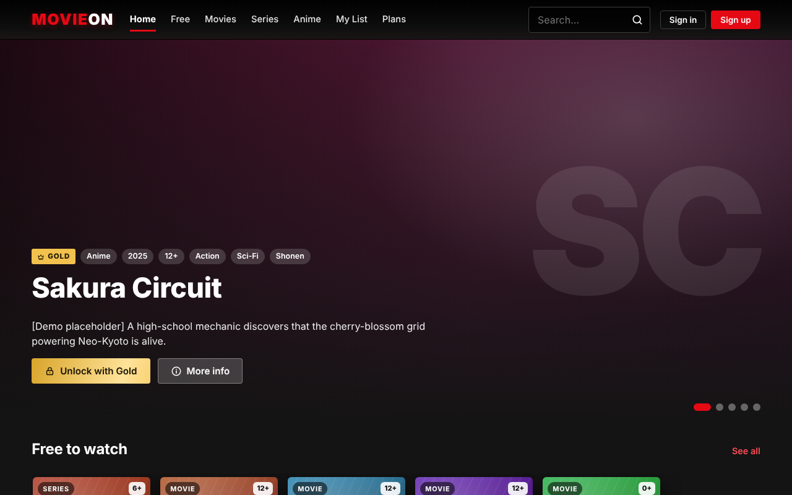
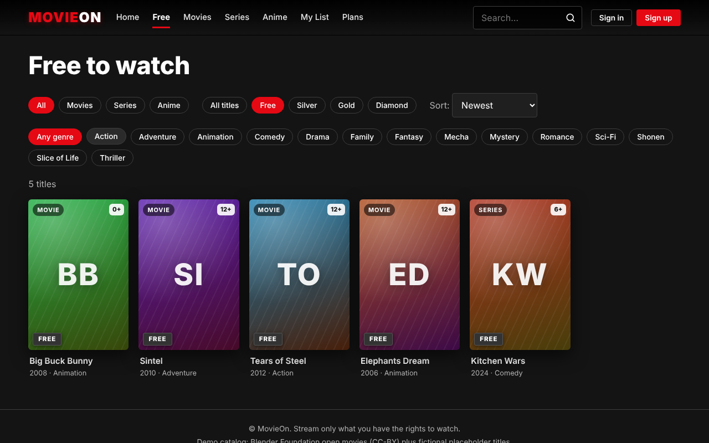
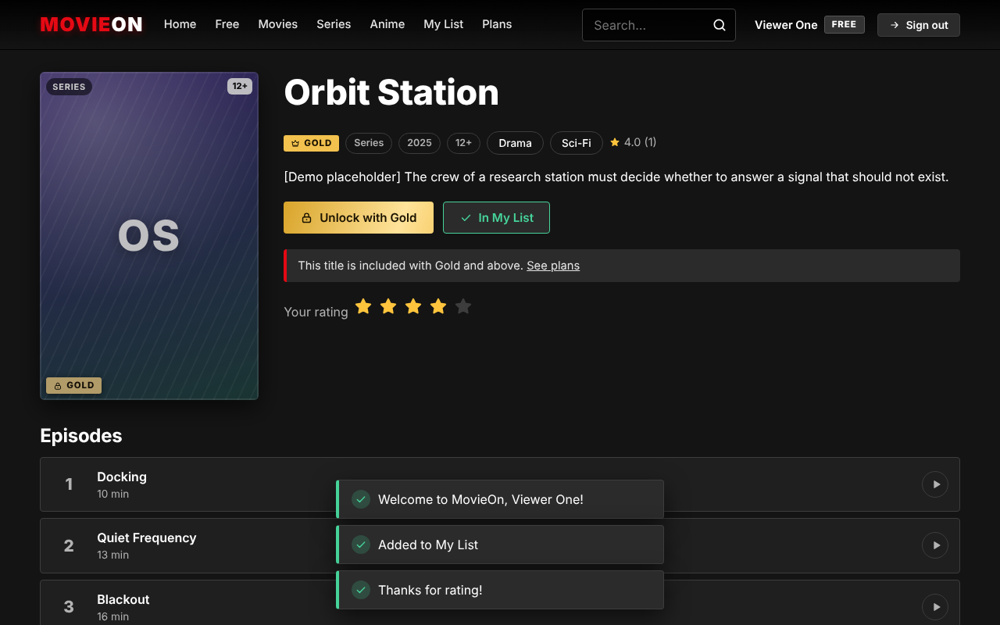
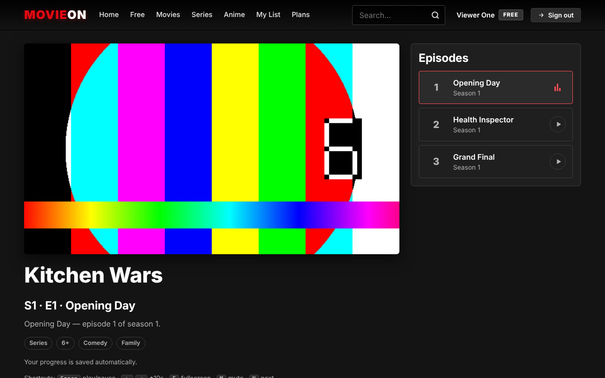
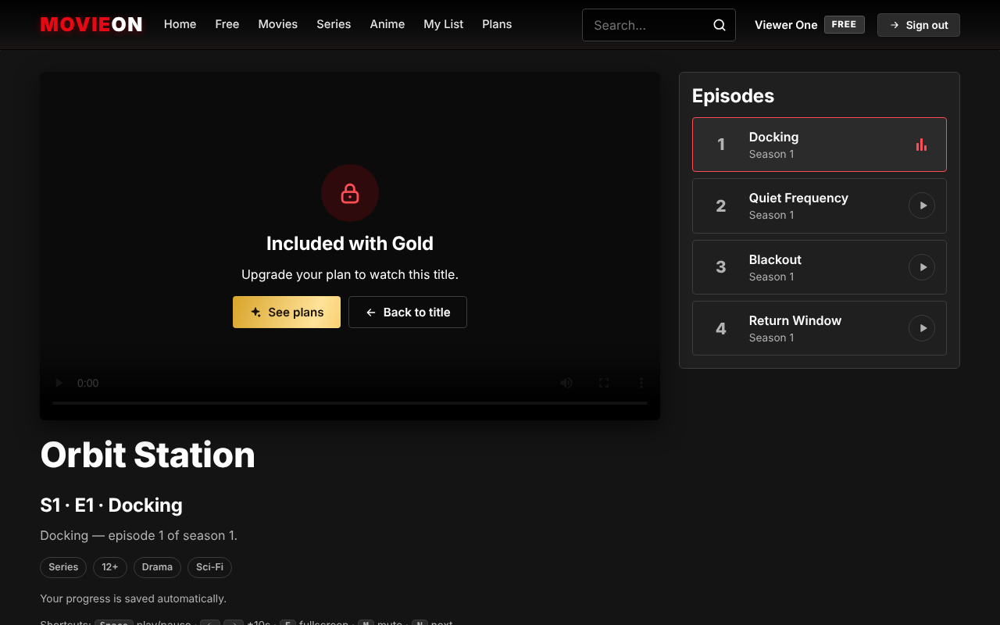
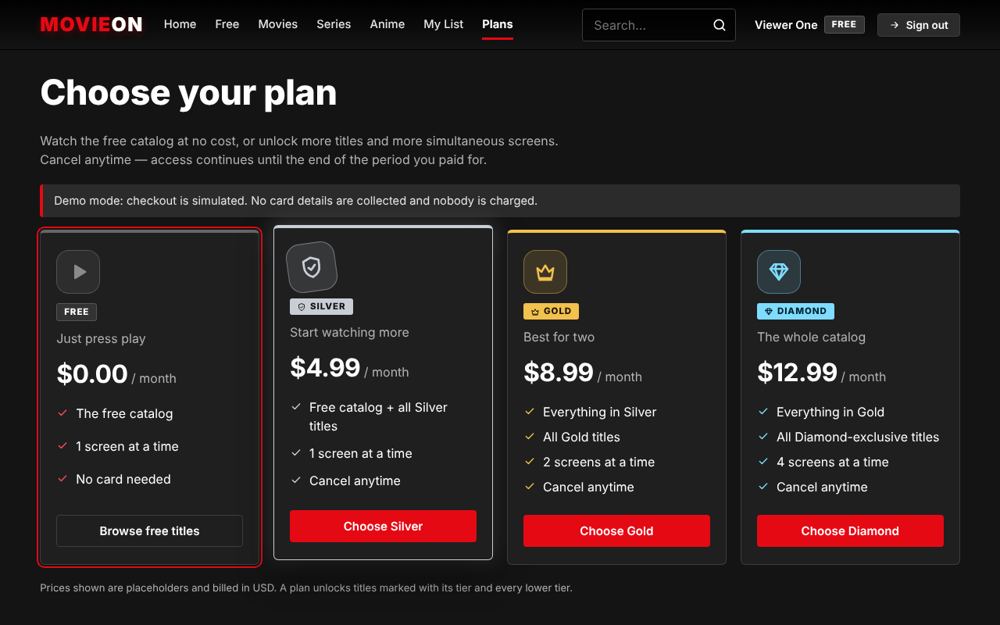
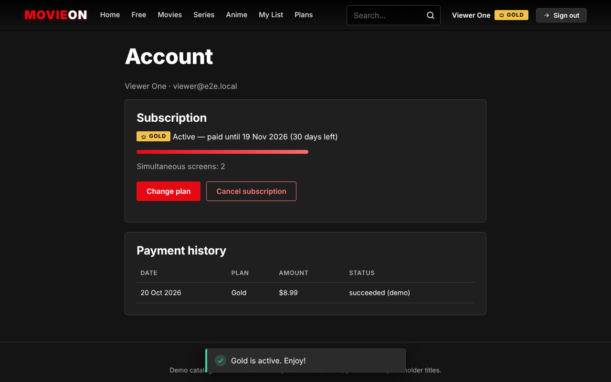
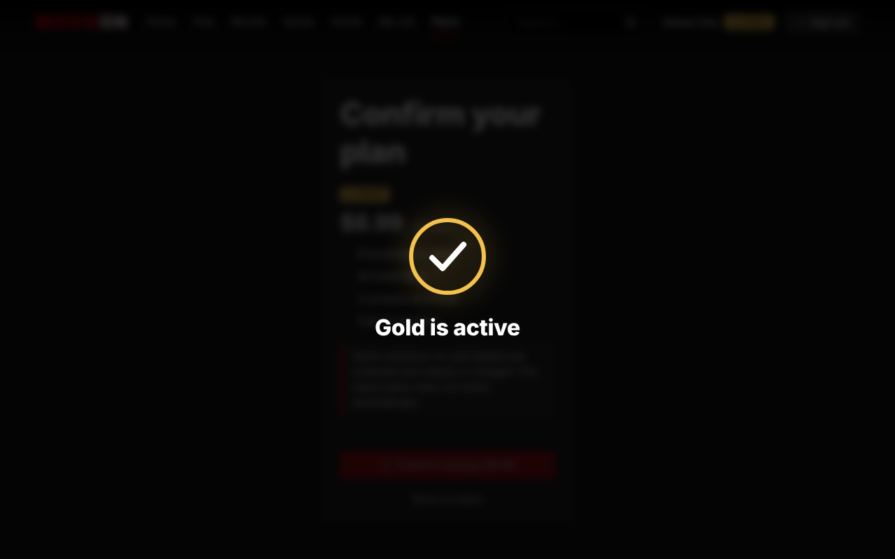
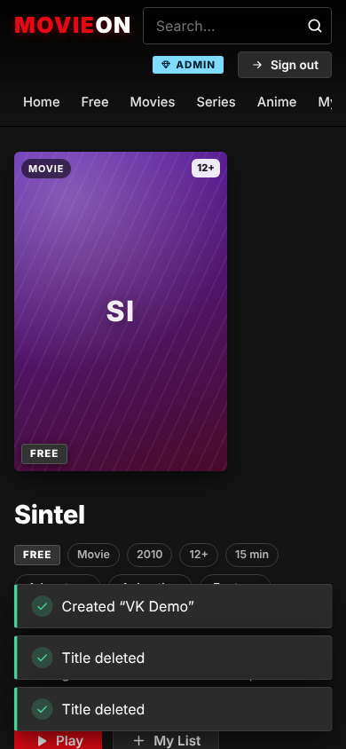

# MovieOn — Functions Overview

Version 1.1.1 · 2026-10-20

This document lists **every function the product provides**, grouped by who uses it, with the requirement ID (`FR-xx`, see `01-planning-and-requirements.md`) and what is — and is not — enforced. Screenshots are from the automated browser test (`e2e/smoke.mjs`) running against the real application; the test video is a generated colour-bar clip, not a film.

## 1. Who uses MovieOn

| Actor | Can do |
|---|---|
| **Visitor** (not signed in) | Browse, search, open title pages, watch **free** titles, see plans |
| **Viewer** (signed in, Free plan) | Everything above + watchlist, ratings, saved progress / Continue watching, subscribe |
| **Subscriber** (Silver / Gold / Diamond) | Everything above + titles of the plan's tier and lower, more simultaneous screens, account page |
| **Admin** | Everything (admins are treated as Diamond) + back-office: titles, episodes, tiers, rights notes, VK embeds, grant / revoke plans |
| **Operator** | Deploys, configures (`BILLING_PROVIDER`, `COOKIE_SECURE`, …), backs up, monitors (see `04-deployment-and-operations.md`) |

## 2. Plans and what they unlock

| | Free | Silver | Gold | Diamond |
|---|---|---|---|---|
| Price (placeholder, USD / 30 days) | 0 | 4.99 | 8.99 | 12.99 |
| Titles of tier | Free | Free + Silver | + Gold | + Diamond |
| Simultaneous screens | 1 | 1 | 2 | 4 |
| Account needed to watch | free titles: no | yes | yes | yes |

Enforced by the server. **Not** provided: picture-quality tiers (every title has one source), downloads, profiles. Prices and limits live in `server/src/plans.js`.

## 3. Viewer-facing functions

### 3.1 Discover

| Function | Detail | FR |
|---|---|---|
| Home | Rotating hero (locked titles show "Unlock with [plan]"), rows: Continue watching (signed-in), Trending, New releases, **Free to watch**, Movies, Series, Anime | FR-03, FR-22 |
| Browse | Filter by type, **access (All / Free / Silver / Gold / Diamond)** and genre; sort newest / most watched / top rated / A–Z; pagination | FR-04, FR-22 |
| Search | Text search over title and synopsis; empty state; wildcard- and injection-safe | FR-05 |
| Tier labels | Every poster shows Free / Silver / Gold / Diamond; locked posters are dimmed and carry a lock icon | FR-25 |

### 3.2 Title page

| Function | Detail | FR |
|---|---|---|
| Details | Poster, tier, type, year, age rating, genres, synopsis, average rating | FR-06 |
| Episodes | Seasons and episodes with progress bars and "Watched" marks | FR-06 |
| Primary action | Play / Resume from mm:ss / Continue S·E — or **Unlock with [plan]** when the plan does not cover the title | FR-08, FR-25 |
| My List | Add / remove (sign-in required) | FR-09 |
| Rating | 1–5 stars, average and count | FR-10 |

### 3.3 Player

| Function | Detail | FR |
|---|---|---|
| Playback | MP4 and HLS (`.m3u8`; hls.js or native Safari), native controls, fullscreen | FR-07 |
| Authorisation | The video URL is requested from the server at play time; refusal reasons are explained: **sign in**, **upgrade**, **too many screens** | FR-19, FR-21, FR-25 |
| Screen slots | Heartbeat every 30 s; slot freed on exit or 90 s after the last heartbeat; a tab switching episodes replaces its own slot | FR-21 |
| Resume | Position saved every 10 s, on pause and on leaving; reopening continues from the saved point | FR-08 |
| Next episode | Countdown overlay with Play now / Stay here | FR-11 |
| Shortcuts | Space play/pause · ←/→ ±10 s · F fullscreen · M mute · N next | FR-15 |
| Error handling | "Playback problem" panel with Retry (keeps the position) | FR-07 |
| VK embeds | Official VK player in a sandboxed iframe; **no** resume, progress or shortcuts for these | FR-23 |

### 3.4 Account, plans and billing

| Function | Detail | FR |
|---|---|---|
| Register / sign in / sign out | Email + display name + password (≥ 8 chars); httpOnly SameSite=Strict cookie, 7 days; generic "invalid credentials" | FR-01, FR-02 |
| Plans page | Free + Silver / Gold / Diamond cards with price, screens, features; current plan highlighted | FR-18 |
| Checkout | Confirm page; **demo provider**: records a payment, no card fields, no real charge; disabled (with an explanation) when `BILLING_PROVIDER=none` | FR-20 |
| Change plan | Starts a new 30-day period at full price (no proration) | FR-20 |
| Cancel / resume | Cancel stops renewal, access runs to the period end; resume while the period runs | FR-20 |
| Account page | Plan, status and days left, simultaneous screens, payment history | FR-20 |
| Expiry | After the period ends the user falls back to Free; a running stream is stopped at the next heartbeat | FR-19, FR-21 |

### 3.5 Design and accessibility

Red/black dark design with an own wordmark (no third-party logo), responsive from 360 px, keyboard accessible (skip link, visible focus, labelled controls, tier shown as text not only colour), no external fonts / CDNs / trackers (FR-14, FR-16, NFR-04, NFR-09).

**Custom icon set (v1.1.1, FR-26).** All icons are original 24×24 SVGs drawn for this project (`web/js/icons.js`, 21 icons: play, lock, check, plus, close, chevrons, arrows, star, search, shield / crown / gem for Silver / Gold / Diamond, monitor, info, alert, sparkle, retry, film, user). They replace every emoji and text glyph (🔒 ▶ ✓ ★ ✕ ← → ●), so the UI looks identical on every OS, inherits the text colour and can be animated. Icons are decorative (`aria-hidden`); the adjacent text is the accessible name.

**Motion (v1.1.1, FR-27).** Hand-written CSS and a few lines of JS, no animation library:

| Where | Animation |
|---|---|
| App start | Intro splash: MOVIEON drawn letter by letter, red light line; **once per browser session**, click / key skips it |
| Every page | Thin red progress bar while a page loads; page fade-and-rise; header gains a solid backdrop on scroll; animated nav underline |
| Home | Hero background drift, floating giant initials, staggered text entrance, pulsing Play button, gold flowing "Unlock with…" button |
| Rows and grids | Cards rise in one after another; hover lifts the poster, zooms its pattern and fades in a Play (or Lock) button; row arrows appear on hover |
| Tier badges | Periodic sheen on Silver / Gold / Diamond; crown bobs, gem twinkles; the lock's shackle opens on hover |
| Title page | My List button swaps `+` for a drawn ✓ (icon); stars pop in a wave and preview on hover; progress bars grow; episode rows slide on hover |
| Plans | Staggered card entrance, tier-coloured glow and tilted emblem on hover, check marks drawn in sequence, glowing ring on the current plan |
| Checkout | **Celebration**: ring and tick drawn in the plan's colour, particle burst, then the account page |
| Player | Loading spinner (ring + pulsing play glyph), shaking lock / pulsing monitor / alert icons on the gate screens, animated equaliser on the current episode, **circular 8-second countdown** to the next episode |
| Feedback | Toasts with an icon and a draining timer bar; ripple on buttons and chips; error shake on form messages; account period meter |

**Reduced motion.** With the OS setting "reduce motion" the splash and hero rotation are off, every CSS animation and transition is disabled, and content simply appears; the loading spinner becomes a soft fade so that "busy" is still visible. This is covered by an automated test.

## 4. Admin functions

| Function | Detail | FR |
|---|---|---|
| Titles | Create / edit / delete; type (movie, series, anime); synopsis, year, age rating, minutes, genres; published / draft; featured on home | FR-12 |
| Tier | "Available on": Free, or Silver / Gold / Diamond and above | FR-17, FR-24 |
| Sources | Direct MP4 / HLS URL, **or** the official VK embed link (VK page links are rejected, link is validated and rebuilt) | FR-23 |
| Rights note | Mandatory for VK embeds: who owns / licenses the video and that embedding is permitted | FR-23 |
| Episodes | Add (season, number, name, minutes, source) and delete; shows which are VK embeds | FR-12, FR-23 |
| Publish / unpublish | Immediate takedown; drafts are invisible to the public | FR-12 |
| Grant / revoke plan | By user email, plan and number of days (support, partners, pilots) | FR-24 |
| Admin-only data | Admin list exposes the stored source URL and rights note, which no public endpoint does | FR-19 |

## 5. API functions (summary)

| Area | Endpoints |
|---|---|
| Auth | `POST /auth/register`, `POST /auth/login`, `POST /auth/logout`, `GET /auth/me` |
| Catalog | `GET /home`, `GET /genres`, `GET /titles` (type, genre, q, tier, sort, page, limit), `GET /titles/:slug` |
| Playback | `POST /playback`, `POST /playback/:id/heartbeat`, `DELETE /playback/:id` |
| User data | `GET/PUT/DELETE /watchlist…`, `PUT /titles/:id/rating`, `GET /progress`, `GET /progress/:titleId`, `PUT /progress` |
| Billing | `GET /plans`, `GET /billing/subscription`, `POST /billing/checkout`, `POST /billing/cancel`, `POST /billing/resume` |
| Admin | `GET/POST /admin/titles`, `PUT/DELETE /admin/titles/:id`, `GET/POST /admin/titles/:id/episodes`, `DELETE /admin/episodes/:id`, `POST /admin/subscriptions`, `POST /admin/subscriptions/revoke` |
| System | `GET /health` |

Full contracts, validation rules and error codes: `02-design.md` §3.

## 6. System functions (no UI)

| Function | Detail |
|---|---|
| Schema migrations | Ordered, transactional, tracked with `PRAGMA user_version`; v1.0 databases upgrade in place |
| Security headers | helmet CSP (`script-src 'self'`, `frame-src` limited to the VK embed hosts, `frame-ancestors 'none'`), HSTS only over HTTPS |
| Rate limiting | 20 auth attempts / 15 min / IP; 300 requests / min / IP globally |
| CSRF defence | SameSite=Strict cookie, JSON-only bodies, `Origin` check on mutating requests |
| Structured logs | One JSON line per request (no query strings or bodies) |
| Demo seed | 13 titles: 4 Blender open movies (CC-BY) + fictional placeholders, spread over all tiers; `SEED_DEMO=false` for an empty start |
| CLI | `npm run admin -- <email> <password>` creates or promotes an admin |

## 7. Known boundaries (read before launching)

1. **Payments are a demo.** No real money is processed; there is no renewal, proration, invoice or tax logic.
2. **A video URL that was issued can be copied.** Tier checks stop casual bypass; real protection needs signed URLs / DRM (roadmap).
3. **VK:** only the official embed, only for videos you have the right to show; no link extraction. Availability and tracking are VK's.
4. **Prices, plan names and limits are placeholders** to be set by the operator.
5. English-only UI; no subtitles, profiles, parental controls or password reset yet (see roadmap).
