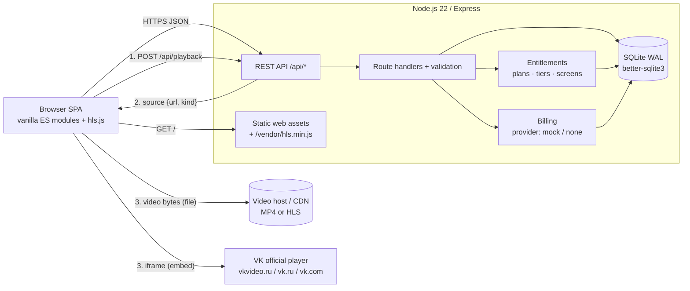
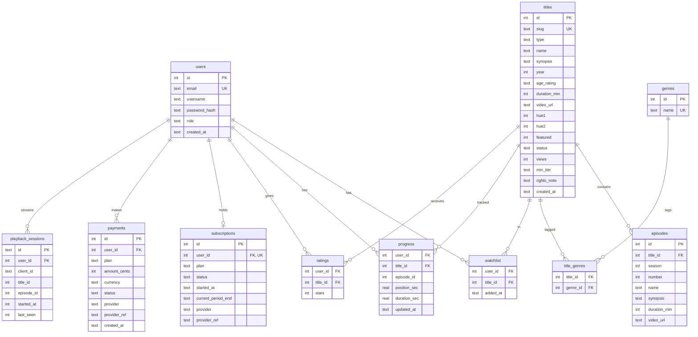
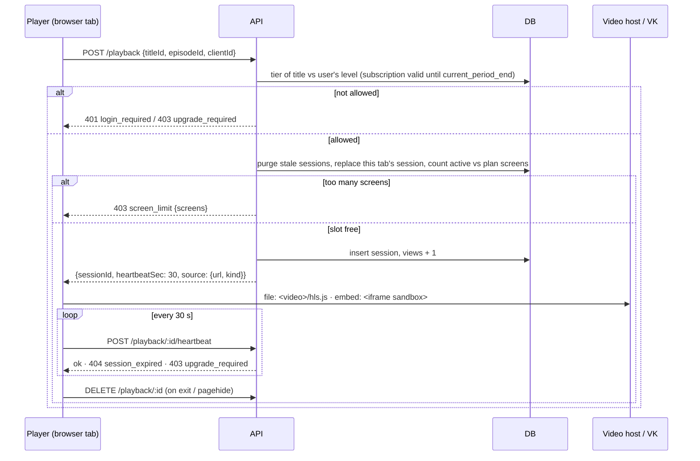

# MovieOn — Phase 2: System Design

Version 1.1.1 · 2026-10-20

> **Changes in 1.1.1:** client only — `icons.js` (SVG icon set), SVG-aware DOM helper, motion layer in `styles.css`, splash / ripple / scroll helpers in `main.js`, route progress bar in `router.js`. See §6 "Icons" and "Motion".
>
> **Changes in 1.1:** entitlements (tiers/plans), playback authorisation endpoint, playback sessions (screen limits), billing with a provider abstraction (demo provider only), VK embed sources, red/black UI, schema migrations V1→V2.

## 1. Architecture overview



- **Monolith** (one deployable) for the MVP: lowest operational cost, simple to reason about.
- **Video bytes never pass through the API.** The client fetches MP4/HLS directly from a video host/CDN (or shows VK's own player in an iframe). The API stores the URL, decides **who may receive it** (tier + screens) and tracks playback progress.
- **No client build step.** Native ES modules keep the repo small and CI fast; hls.js is vendored from npm and served from `/vendor/` so CSP can stay `script-src 'self'`.

### Technology choices and rationale (ADR summary)

| ADR | Decision | Alternatives | Why |
|---|---|---|---|
| ADR-1 | Express 5 on Node 22 | Fastify, NestJS | Ubiquitous, tiny surface, fits MVP |
| ADR-2 | SQLite (better-sqlite3, WAL) | PostgreSQL | Zero-ops for MVP; schema is portable SQL; migration path documented |
| ADR-3 | Cookie session (JWT in httpOnly cookie) | Bearer token in localStorage | Not readable by injected scripts; SameSite=Strict mitigates CSRF |
| ADR-4 | Vanilla JS SPA, hash routing | React/Vite | No toolchain, works on any static host; migrate if UI complexity grows |
| ADR-5 | hls.js + native `<video>` | Video.js, Shaka | Smallest dependency covering HLS; Safari uses native HLS |
| ADR-6 | Generated gradient posters | Stored images | No copyrighted artwork in repo; URL override planned |
| ADR-7 | DOM built with a helper, never `innerHTML` with data | Template strings | Eliminates a whole XSS class |
| ADR-8 | Entitlements enforced on the server; video URLs withheld from public payloads and issued by `POST /api/playback` | Client-side hiding of locked titles | A client-side check is cosmetic; the URL must not exist in the response of a locked title |
| ADR-9 | Billing behind a provider switch (`BILLING_PROVIDER` = `mock` \| `none`); subscriptions written only by the billing layer or by an admin | Hard-wiring a payment SDK now | Lets the whole subscription flow be built and tested without credentials or card data; a real provider only needs to replace the checkout and write the same rows from a webhook |
| ADR-10 | VK supported **only** through its official embed player, with a mandatory rights note | Extracting direct stream URLs from VK | Extraction bypasses VK's player/terms and encourages unlicensed content; the embed is a supported, documented mechanism |
| ADR-11 | Numbered migrations (`PRAGMA user_version`) | `CREATE TABLE IF NOT EXISTS` only | Required once the schema changes (V2); keeps old databases upgradeable |
| ADR-12 | Dark-only red/black design | Dual theme | One carefully checked palette instead of two; matches the product's cinematic positioning |

## 2. Data model



Constraints: `titles.type IN ('movie','series','anime')`; `titles.status IN ('published','draft')`; `titles.min_tier IN ('free','silver','gold','diamond')` default `free`; `episodes UNIQUE(title_id, season, number)`; `ratings.stars BETWEEN 1 AND 5`; `progress` PK `(user_id, title_id, episode_id)` with `episode_id = 0` for movies; `subscriptions.user_id` UNIQUE (one row per user), `plan IN ('silver','gold','diamond')`, `status IN ('active','canceled')`; foreign keys `ON DELETE CASCADE`. Indexes on `titles(type,status)`, `titles(views)`, `titles(created_at)`, `episodes(title_id)`, `payments(user_id, id)` and `playback_sessions(user_id, last_seen)`.

Movies carry `video_url` on the title. Series and anime carry URLs on episodes. A URL is either a direct file (MP4 / HLS) or a normalised VK embed link (`kind = embed`); `rights_note` is mandatory for embeds.

**Migrations.** `server/src/db.js` holds an ordered list: **V1** = the original schema (idempotent), **V2** = tiers, rights note, subscriptions, payments, playback sessions. On start, `migrate()` reads `PRAGMA user_version`, applies each missing migration in its own transaction and bumps the version. A v1.0 database (version 0) is upgraded in place; existing titles become `free`. Covered by an automated test.

## 3. REST API

Base path `/api`. JSON in/out. Auth is the `mo_token` cookie. Errors: `{ "error": "message", "code"?: "…" }` with proper status codes (400 validation, 401 unauthenticated, 403 forbidden, 404, 409 conflict, 429 rate limit, 503 feature disabled). Machine-readable `code` values used by the client: `login_required` (401), `upgrade_required` (403, with `requiredTier`), `screen_limit` (403, with `screens`), `session_expired` (404), `billing_disabled` (503), `already_subscribed` (409).

Rows in **bold** are new in v1.1.

| Method & path | Auth | Description |
|---|---|---|
| GET `/health` | – | Liveness + DB check |
| POST `/auth/register` | – | `{email, username, password}` → 201 `{user, access}` + cookie |
| POST `/auth/login` | – | `{email, password}` → `{user, access}` + cookie |
| POST `/auth/logout` | – | Clears cookie |
| GET `/auth/me` | optional | `{user, access}`; `access = {level, plan, screens, subscription}` |
| GET `/genres` | – | Genre list |
| GET `/home` | optional | Hero + rows (trending, new, **free to watch**, movies, series, anime, continue) |
| GET `/titles` | – | Query: `type, genre, q, tier(free\|silver\|gold\|diamond), sort(newest\|name\|rating\|popular), page, limit` → `{items,total,page,pages}`; items carry `minTier` |
| GET `/titles/:slug` | optional | Details, genres, episodes (no URLs), `minTier`, `canWatch`, `hasSource`, rating avg/count, user rating, in-watchlist |
| PUT `/titles/:id/rating` | user | `{stars:1..5}` |
| **POST `/playback`** | optional | `{titleId, episodeId?, clientId}` → `{sessionId, heartbeatSec, source:{url, kind:'file'\|'embed'}}` after tier + screen checks; counts the view. Anonymous viewers get `sessionId: null` and only free titles |
| **POST `/playback/:id/heartbeat`** | user | Keeps the screen slot alive; re-checks entitlement |
| **DELETE `/playback/:id`** | user | Releases the slot |
| GET `/watchlist` | user | Titles in the list |
| PUT `/watchlist/:titleId` | user | Add (idempotent) |
| DELETE `/watchlist/:titleId` | user | Remove |
| GET `/progress/:titleId` | user | Progress rows for a title |
| PUT `/progress` | user | `{titleId, episodeId?, position, duration}` |
| GET `/progress` | user | Continue-watching list |
| **GET `/plans`** | – | `{plans, checkoutEnabled, provider, periodDays}` |
| **GET `/billing/subscription`** | user | Subscription (also an expired one, `active:false`), access, last 20 payments |
| **POST `/billing/checkout`** | user | `{plan}` → 201 (demo provider only; 503 `billing_disabled` otherwise; 409 if already on that plan) |
| **POST `/billing/cancel`** | user | No renewal; access until period end |
| **POST `/billing/resume`** | user | Undo cancel while the period is still running |
| POST `/admin/titles` | admin | Create title (+genres, `minTier`, `rightsNote`) |
| PUT `/admin/titles/:id` | admin | Update title |
| DELETE `/admin/titles/:id` | admin | Delete title (cascade) |
| GET `/admin/titles` | admin | All titles incl. drafts, with `videoUrl`, `rightsNote`, `sourceKind` |
| **GET `/admin/titles/:id/episodes`** | admin | Episodes with `videoUrl`, `sourceKind` |
| POST `/admin/titles/:id/episodes` | admin | Add episode (embed requires the title's rights note) |
| DELETE `/admin/episodes/:id` | admin | Remove episode |
| **POST `/admin/subscriptions`** | admin | `{email, plan, days}` → grant (provider `admin`) |
| **POST `/admin/subscriptions/revoke`** | admin | `{email}` → remove subscription and playback sessions |

Removed in 1.1: `POST /titles/:id/view` (views are now counted when playback is authorised, so a client cannot inflate them without passing the checks).

Validation rules: email RFC-lite regex ≤ 254 chars; username 2–32 chars `[\w .-]`; password 8–72 chars (bcrypt limit); `clientId` 8–64 chars `[\w-]`; video URLs must be `http(s)://`; VK-host URLs must be an `https://…/video_ext.php?oid=…&id=…[&hash=…][&hd=1-5]` embed (rebuilt from validated parts); text lengths bounded; page size ≤ 50; all identifiers integers.

## 4. Security design

**Assets:** accounts, watch history, catalog integrity, availability.

| STRIDE | Threat | Control |
|---|---|---|
| Spoofing | Credential stuffing | bcrypt, 20 auth attempts / 15 min / IP, generic "invalid credentials" |
| Tampering | SQL injection | prepared statements only |
| Tampering | CSRF | SameSite=Strict cookie, JSON-only bodies, `Origin` check on mutating requests |
| Repudiation | Admin changes untracked | Request logging with user id (full audit table in roadmap) |
| Info disclosure | XSS stealing session | httpOnly cookie, CSP `script-src 'self'`, no `innerHTML` with data |
| Info disclosure | User enumeration | same response for unknown email vs bad password; register conflict is the one accepted leak (documented) |
| DoS | Request floods | global rate limit 300 req/min/IP, body limit 100 kB, pagination caps |
| Elevation | User hits admin API | `requireAdmin` middleware on `/api/admin`, role read from DB per request |
| Elevation | Free user watches a paid title by calling the API directly | Tier check in `POST /playback`; public payloads contain no URLs; client UI is cosmetic only |
| Tampering | Client inflates views | Views counted only inside an authorised `POST /playback` |
| Elevation | Account sharing beyond the plan | Per-user screen limit with heartbeat/expiry; own-tab replacement; entitlement re-checked on each heartbeat |
| Info disclosure | Copying the media URL after authorisation | **Not preventable without signed URLs/DRM** — accepted for v1.1 (see R9, roadmap v1.4/v2.0) |
| Tampering | Fake payment / self-granted plan | `BILLING_PROVIDER=none` by default in production (checkout returns 503); demo provider is dev-only; admin grants are audited via `provider='admin'`, `provider_ref` |
| Tampering | Malicious iframe source | Embed hosts allow-listed (`vkvideo.ru`, `vk.ru`, `vk.com`), HTTPS and `/video_ext.php` only, URL rebuilt from validated parts, iframe `sandbox`, CSP `frame-src` limited to those hosts |
| Info disclosure | Payment data | No card data collected or stored; only plan, amount, currency, status, provider reference |

Headers via helmet: CSP (`default-src 'self'; img-src 'self' data: https:; media-src 'self' blob: https:; connect-src 'self' https:; script-src 'self'; style-src 'self'; frame-src https://vkvideo.ru https://vk.ru https://vk.com; frame-ancestors 'none'`), `X-Content-Type-Options`, `Referrer-Policy`; HSTS and `upgrade-insecure-requests` are added only when `COOKIE_SECURE=true` (i.e. when served over HTTPS), because they would break a plain-HTTP run. `connect-src https:` is needed so hls.js can fetch playlists/segments from the CDN; tighten to an allow-list of the operator's hosts in production (`MEDIA_ORIGINS` env).

Secrets: `JWT_SECRET` mandatory in production (process exits otherwise). Default admin credentials are never created in production unless `ADMIN_EMAIL` and `ADMIN_PASSWORD` are provided.

## 5. Video delivery and playback authorisation



- **Sessions:** a slot is a row in `playback_sessions`; it expires 90 s after the last heartbeat, so crashed or sleeping clients free their slot. The per-tab `clientId` (kept in `sessionStorage`) lets a tab switch episodes without counting against itself.
- **Entitlement window:** a subscription grants access while `current_period_end` is in the future, whether `active` or `canceled`. Admin accounts are treated as Diamond.
- **File sources:** URL pointer to MP4 (progressive download, HTTP range) or HLS master playlist. If the URL ends with `.m3u8` and the browser lacks native HLS → hls.js with automatic quality switching; otherwise set `video.src`. On fatal error show a retry panel.
- **VK embeds:** an `<iframe>` to the official player with `sandbox="allow-scripts allow-same-origin allow-presentation allow-popups"` and `allow="autoplay; encrypted-media; fullscreen; picture-in-picture"`. Because the player is cross-origin, **progress saving, resume, next-episode autoplay and keyboard shortcuts do not apply** to embeds; the UI says so.
- **Progress (file sources):** saved every 10 s, on pause, on `visibilitychange` and `pagehide` via `fetch(keepalive)`.
- **Target pipeline (v1.4):** upload → FFmpeg ladder (240p–1080p, AAC, H.264) → HLS segments in object storage → CDN with short-lived signed URLs → optional DRM (v2.0).

## 6. UI / UX design

**Information architecture**

```
Home ─┬─ Browse (Free | Movies | Series | Anime, access chips, genre chips, sort)
      ├─ Search
      ├─ Title ─ Watch (player + episode list; login / upgrade / screen-limit states)
      ├─ Watchlist
      ├─ Plans ─ Checkout (demo)
      ├─ Account (subscription, cancel/resume, payment history)
      ├─ Login / Register
      └─ Admin (admin only: titles, tiers, rights notes, grant/revoke plans)
```

**Visual language (v1.1):** black/charcoal surfaces (`#141414`, `#1f1f1f`), signal red `#e50914` for primary actions and the wordmark (white text on it ≈ 4.8:1), lighter red `#ff4d55` for red text on dark (≥ 5:1), white/grey text; a bold uppercase **MOVIEON** wordmark (no third-party logos or names); squared 4–6 px corners; full-bleed hero with a dark gradient into the page; Helvetica/Arial-style system font stack (no external fonts); 8 px spacing scale; posters 2:3.

**Tier colours:** Free = charcoal, Silver `#c9ced6`, Gold `#f2c14e`, Diamond `#7fdcff` — always shown as a text label (never colour alone). Locked posters are desaturated and carry a lock icon.

**Icons (1.1.1).** `web/js/icons.js` exports `icon(name, {size, class})`, which builds an inline `<svg viewBox="0 0 24 24">` with `createElementNS` (the DOM helper `h()` knows the SVG namespace, so no `innerHTML`, no sprite fetch and no `style` attribute — compatible with `script-src 'self'` and `style-src 'self'`). Line icons use `stroke="currentColor"`, 2 px round caps; `play` and the small dots are solid. Parts that animate carry classes (`ic-shackle`, `ic-check` with `pathLength=1`, …). Helpers: `TIER_ICON` (shield / crown / gem), `equalizer()` (now-playing bars), `spinner()` (player loader). Emoji and glyph characters are not used anywhere (an e2e step scans the visible text for them).

**Motion (1.1.1).** Principles: (1) the un-animated state is always the final, visible state and keyframes describe only the way in, so disabling animation can never hide content; (2) only compositor-friendly properties (`transform`, `opacity`, `stroke-dashoffset`, `box-shadow`) are animated; (3) JavaScript only toggles classes or sets CSS custom properties (`--i` stagger index, `--dur`, `--rx/--ry` ripple origin) through the CSSOM; (4) `@media (prefers-reduced-motion: reduce)` switches off all animation and transition, the splash and hero auto-rotation. Easing tokens: `--ease-out: cubic-bezier(.22,1,.36,1)` and an overshoot `--spring`. Implemented pieces: `splash()` in `main.js` (sessionStorage flag, closes after ≈ 1.5 s or on click / key), `route-loading` class on `<html>` driving the top progress bar, document-level pointer handler for the ripple, scroll listener (passive) for the header, `celebrate()` in `ui.js` (SVG ring/tick + 22 CSS-driven particles), countdown ring driven by one CSS animation of `--dur` seconds while a 1 s timer updates the number and an `aria-live` text.

**Design tokens** (CSS custom properties): `--bg, --surface, --surface-2, --border, --text, --muted, --accent, --accent-strong, --silver, --gold, --diamond, --radius, --shadow, --ease-out, --spring`. The page declares `color-scheme: dark`; there is no theme toggle.

**Accessibility:** semantic landmarks, skip link, visible focus rings, labelled controls, `aria-live` for toasts, `prefers-reduced-motion` honoured (all motion off, splash skipped), decorative icons are `aria-hidden`, the countdown number is mirrored in a polite live region, cards are real links and their accessible name includes the plan ("…, Gold plan" / "…, free"), tier is never conveyed by colour alone.

**States designed for every list:** loading skeleton, empty, error with retry. **Player states:** playing, playback problem (retry), sign-in required, upgrade required, screen limit, next-episode countdown.

## 7. Scalability path

1. Put the container behind a reverse proxy/CDN; cache `/vendor` and static assets (immutable, hashed in v1.1).
2. Move DB to PostgreSQL (schema uses portable SQL; swap the thin `db.js` layer).
3. Add Redis for rate-limit counters, view-count buffering and cache of `/api/home`.
4. Split video ingest/transcoding into a worker service with a queue.
5. Search: Postgres `pg_trgm`/full-text first, dedicated engine later.

## 8. Entitlements and billing design

**Plans** (single source of truth: `server/src/plans.js`; prices are placeholders in USD):

| Plan | Tier unlocked | Screens | Price / 30 days |
|---|---|---|---|
| Free (no plan) | `free` | 1 | 0 |
| Silver | `free`, `silver` | 1 | $4.99 |
| Gold | + `gold` | 2 | $8.99 |
| Diamond | + `diamond` | 4 | $12.99 |

**Rules**
1. Level = 0 (free) · 1 Silver · 2 Gold · 3 Diamond; a user may watch a title when `level ≥ level(title.min_tier)`.
2. Subscription valid while `current_period_end > now`. `canceled` only means "do not renew".
3. Changing plan starts a **new 30-day period at the full price** (no proration — documented limitation). Subscribing to the plan you already have returns 409.
4. The demo provider does **not** renew automatically; when the period ends the user falls back to Free.
5. Not enforced: picture quality per plan (each title has one source), download limits, device types.

**Provider boundary.** `BILLING_PROVIDER=mock` (default in development) enables `POST /billing/checkout`, which writes a `subscriptions` row and a `payments` row in one transaction. `none` (default in production) disables it and the UI says payments are not enabled. A real provider replaces checkout with a redirect to the provider's hosted page and writes the same two rows from a **signed webhook** (verify signature, idempotent on `provider_ref`, handle renewal/failed payment/refund) — see `04-deployment-and-operations.md` §12.
