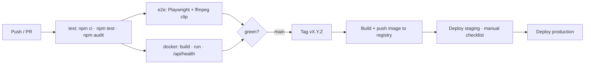

# MovieOn — Phases 5–6: Deployment & Maintenance

Version 1.1.1 · 2026-10-20

> **Changes in 1.1.1:** none for operators — client-only release (icons, animations); same configuration, image and database schema.

> **Changes in 1.1:** `BILLING_PROVIDER` setting, VK frame allow-list in the CSP, automatic schema upgrade (migrations), subscription/payment operations (§12), content-compliance rules for embeds.

## 1. Environments

| Env | Purpose | Data | Notes |
|---|---|---|---|
| Local dev | Daily work | Demo seed, SQLite file in `server/data/` | `npm run dev`; dev admin `admin@movieon.local` / `admin12345` is created **only** when `NODE_ENV` is not `production` and no admin env vars are set |
| CI | Automated checks | In-memory SQLite | GitHub Actions: API tests + audit → browser e2e → Docker build and health check |
| Staging | Pre-release verification, manual checklist | Copy of production catalog (no user data) | Same container, `COOKIE_SECURE=true` behind TLS |
| Production | Live | Real catalog, `SEED_DEMO=false` | Single container + persistent volume behind a TLS-terminating reverse proxy/CDN |

## 2. Configuration

| Variable | Default | Required in prod | Meaning |
|---|---|---|---|
| `NODE_ENV` | – | yes (`production`) | Enables production defaults |
| `PORT` | 3000 | no | Listen port |
| `DB_PATH` | `./data/movieon.db` (`/data/movieon.db` in the image) | no | SQLite file; mount a volume |
| `JWT_SECRET` | random per boot in dev | **yes** — process exits if missing | Session signing key; rotating it logs everyone out |
| `ADMIN_EMAIL`, `ADMIN_PASSWORD` | dev admin only outside production | **yes** (first start) | Applied only when that account does not exist yet. v1.0 has no password-change or role UI — use the admin CLI (section 6) to reset a password or promote a user |
| `COOKIE_SECURE` | `true` in production | set `true` behind HTTPS | Secure cookie flag; also enables HSTS and CSP `upgrade-insecure-requests`. Set `false` only for plain-HTTP local runs |
| `SEED_DEMO` | `true` | set `false` | Insert demo catalog when the DB is empty |
| `MEDIA_ORIGINS` | any `https:` | recommended | Comma-separated video/CDN origins allowed by CSP (`media-src`, `connect-src`) |
| `TRUST_PROXY` | off | yes behind a proxy | Number of proxies, so rate limiting uses real client IPs |
| `BILLING_PROVIDER` | `mock` in development, `none` in production | **keep `none` until a real provider exists** | `mock` = demo checkout that records a payment without charging anyone or collecting card data. `none` = checkout disabled (HTTP 503; the UI says payments are not enabled); plans can still be granted by an admin. The server logs a warning if `mock` is used in production |
| `WEB_DIR` | `../web` | no | Static client directory |

## 3. Running

**Without Docker (Node 22+)**
```bash
cd server
npm ci
npm start                       # http://localhost:3000
npm test                        # 66 API tests
```

**With Docker Compose**
```bash
cp .env.example .env            # set JWT_SECRET, ADMIN_EMAIL, ADMIN_PASSWORD
docker compose up --build -d
curl http://localhost:3000/api/health
```
The image is multi-stage (build tools only in the dependency stage), runs as the unprivileged `node` user, stores data in the `/data` volume, and has a `HEALTHCHECK` on `/api/health`.

**Production topology (recommended)**
```
Internet ─► CDN / reverse proxy (TLS, HTTP/2, gzip/brotli, WAF)
              ├─► MovieOn container  (/, /api, /vendor)
              └─► Video origin / object storage (MP4, HLS) — served directly to browsers, with HTTP Range
```
Reverse proxy checklist: terminate TLS; forward `X-Forwarded-For`/`-Proto`; set `TRUST_PROXY=1`; compress text assets; cache `/vendor/*` and static files; **do not** cache `/api/*`.

## 4. CI/CD pipeline


The repository contains the CI stages (`.github/workflows/ci.yml`). Registry push and deployment are environment-specific and intentionally left to the operator (they need credentials/targets that do not belong in the repo).

## 5. Release process

1. Branch from `main`; one PR per change; CI must be green; at least one reviewer.
2. Versioning: SemVer. Breaking API/DB changes bump the major version.
3. Release candidate → staging → manual checklist (`03-testing.md` §6) → production.
4. **Rollback:** redeploy the previous image tag. Schema changes must be backward compatible for one release (expand → migrate → contract) so a rollback never needs a DB restore.
5. Changelog entry per release; known limitations updated.

## 6. Database operations

- SQLite runs in WAL mode; the database consists of `movieon.db`, `-wal`, `-shm`.
- **Backup:** use SQLite's online backup, not a raw copy of a live file:
  ```bash
  docker compose exec movieon node -e "const D=require('better-sqlite3');new D('/data/movieon.db').backup('/data/backup-'+Date.now()+'.db').then(()=>console.log('ok'))"
  ```
  Schedule daily, keep 14 days, copy off-host, **test a restore quarterly**.
- **Admin accounts (v1.0):** create, promote or reset a password with the CLI (new users otherwise get role `user`):
  ```bash
  docker compose exec movieon node src/admin-cli.js admin@example.com 'a-long-new-passphrase'
  # without Docker: cd server && npm run admin -- admin@example.com 'a-long-new-passphrase'
  ```
- **Migrations (implemented in 1.1):** `server/src/db.js` keeps an ordered list (V1 base schema, V2 tiers/subscriptions/payments/playback sessions). On start the server reads `PRAGMA user_version` and applies missing migrations, each in a transaction. A v1.0 database upgrades automatically on first start of v1.1 (existing titles become `free`). **Take a backup before upgrading** (command above). Rolling back to a v1.0 image after the upgrade is *not* supported by the schema bump — restore the pre-upgrade backup instead. Add future changes as new entries (V3, …); never edit an applied one.
- **Subscription data:** `subscriptions` (one row per user), `payments` (append-only history), `playback_sessions` (ephemeral, rows older than 90 s are purged lazily). Payment history must be retained according to local accounting/tax rules — confirm the retention period with an accountant before deleting any `payments` rows.
- **Scale trigger:** move to PostgreSQL when sustained write contention appears (progress writes arrive every 10 s per active viewer — roughly 100 writes/s at 1 000 concurrent viewers) or when running more than one app instance.

## 7. Monitoring & alerting

| Signal | Source | Alert |
|---|---|---|
| Availability | `GET /api/health` from an external prober (1 min) | 3 consecutive failures → page |
| Error rate | JSON request logs (`s` ≥ 500) | > 1 % over 5 min |
| Latency | Request logs (`ms`) | p95 > 500 ms over 10 min |
| Auth abuse | Count of 401/429 on `/api/auth/*` | Spike vs baseline |
| Disk | Volume usage | > 80 % |
| Container health | Docker `HEALTHCHECK` | Restart loop |
| Video availability | Synthetic fetch of a sample of media URLs (HEAD with Range); VK embeds are checked manually | Any title unreachable for > 15 min |
| Playback authorisation | Request logs: share of `POST /api/playback` returning 403 (`screen_limit` / `upgrade_required`) | Sudden spike (bug or sharing wave) |
| Billing | Provider webhook failures, `payments.status != 'succeeded'` (once a real provider exists) | Any failed webhook for > 15 min |

Logs are one JSON object per request on stdout: `{t, m, p, s, ms, u}` (time, method, path without query string, status, duration, user id). Query strings and bodies are deliberately **not** logged (they can contain search terms or credentials). Ship stdout to the platform's log service and set a retention period consistent with the privacy policy.

## 8. Security operations

- Rotate `JWT_SECRET` at least annually and after any suspected leak (forces re-login).
- `npm audit` runs in CI; also enable Dependabot/Renovate; patch High/Critical within 7 days.
- Rebuild the image monthly to pick up base-image fixes.
- Admin accounts: use unique long passwords; review the list of admins quarterly (v1.1 adds an audit log and 2FA).
- Incident response: contain (unpublish content or take the service offline) → preserve logs → rotate secrets → notify affected users where required by law → post-mortem within 5 working days.

## 9. Content compliance & takedown

1. Maintain a **rights register** outside the app: title, licensor, territories, start/end dates, contract reference.
2. Publish a contact address for rights holders and a notice-and-takedown policy (DMCA-style and local-law equivalents).
3. On a valid notice: Admin → *Unpublish* (immediate, reversible) or *Delete*; confirm the title returns 404 to anonymous users; record the action and time in the register.
4. Remove titles at licence expiry; geo-restriction support (v1.3) is required before signing territory-limited licences.
5. Do not add sources you are not licensed for. The player will play any URL an admin enters, so this is an organisational control, not a technical one.
6. **VK embeds.** Only add a VK video if the operator owns it or has written permission to show it; paste the official embed link (VK page links are rejected) and fill the **Rights note** (it is mandatory and visible to admins). Record the same item in the rights register. Do not use videos uploaded by third parties without a licence merely because they are public on VK. If VK removes a video or disables embedding, the title shows VK's error — unpublish it.
7. **Tier assignment** is a commercial decision recorded with the licence (e.g. which titles are free). Changing a title's tier takes effect immediately for new playback starts; running sessions are re-checked at their next heartbeat (≤ 30 s), so raising a title's tier also stops viewers who no longer qualify (the player is replaced by the upgrade message).

## 10. Maintenance plan

| Cadence | Activity |
|---|---|
| Daily | Backup job result, health/alerts review |
| Weekly | Dependency updates, review error logs, check media-URL probe results |
| Monthly | Base-image rebuild, access review, capacity check (DB size, video egress cost) |
| Quarterly | Restore drill, accessibility re-check, penetration-test baseline, roadmap review |
| Annually | Secret rotation, licence/rights audit, DR exercise |

Support model: issues triaged by severity — S1 (site down / data loss) 1 h response; S2 (core feature broken) 1 working day; S3 (cosmetic/minor) next sprint.

## 11. Roadmap and known gaps (v1.1 → next)

| Gap | Impact | Planned |
|---|---|---|
| **No real payment provider**: demo checkout only, no automatic renewal, proration, invoices, tax, refunds, dunning | Cannot charge customers | v1.2 (see §12) |
| URL of an authorised video can be copied and shared | Paid content leakage | v1.4 signed expiring URLs, v2.0 DRM |
| Plans differ by catalog and screens only; no resolution tiers | Marketing copy must not promise quality tiers | v1.4 with a transcoding ladder |
| VK embeds: no progress/resume, no next-episode autoplay, availability controlled by VK | Weaker UX for embedded titles | accepted; prefer self-hosted licensed files |
| No password reset / email verification / password change | Account recovery is manual | v1.2 |
| No subtitles / audio tracks | Accessibility and localisation | v1.2 (WebVTT) |
| No user data export/delete | Privacy-law readiness | v1.2 |
| No audit log of admin actions (grants/revokes are only labelled in `subscriptions.provider_ref`) | Accountability | v1.2 |
| Single SQLite instance, no cache; `/api/home` is the slowest read | Scale ceiling | v1.3 (PostgreSQL, Redis cache for `/api/home`) |
| No parental controls (labels only) | Child safety | v1.3 |
| No upload/transcoding; videos referenced by URL | Operator must host video elsewhere | v1.4 |
| No geo-restrictions | Needed for territory-limited licences | v1.4 |
| UI strings inline (English only) | Localisation | v1.2 (ru, uz) |

## 12. Payments and subscriptions — operating notes

**Today (v1.1).** `BILLING_PROVIDER=mock` is for demos, staging and tests only. Do **not** enable it on a public site: anyone could "buy" a plan for free. In production leave `none` and use **Admin → Grant a plan** (or `POST /api/admin/subscriptions`) for support cases, partners and pilot users; plans granted this way are labelled `provider='admin'` and the account page does not offer a cancel button for them (support revokes instead).

**Integrating a real provider (checklist, not implemented).**
1. Choose a provider that offers a **hosted checkout** and **signed webhooks** so card data never reaches this server (candidates to evaluate: Stripe for international customers; regional providers such as Payme/Click for Uzbekistan — availability, fees, legal requirements and API fit are *not* verified here). Settle currency (prices are USD placeholders) and tax/VAT with an accountant.
2. Replace the body of `POST /billing/checkout` with creation of a provider checkout session and a redirect; keep `GET /plans` and the UI.
3. Add a `POST /billing/webhook/<provider>` route that verifies the signature, is idempotent on `provider_ref`, and writes the same rows: upsert `subscriptions` (`plan`, `current_period_end` from the provider's period) and insert `payments`. Handle: first payment, renewal (extend the period), failed payment (grace period, then let the period lapse), cancellation, refund/chargeback (remove access).
4. Set `BILLING_PROVIDER=<provider>`; allow `checkoutEnabled` only for it. Remove/disable the `mock` branch in production builds.
5. Add monitoring for webhook failures (§7) and a reconciliation report: provider payments vs `payments` rows.
6. Publish pricing, renewal, cancellation and refund terms; obtain legal review for consumer-protection requirements in the target countries.

**Support playbook.**
- *"I paid but I'm still Free"* → check `GET /billing/subscription` data for the user (DB row), provider dashboard, webhook log; if confirmed paid, grant the plan for the paid period and fix the root cause.
- *"I can't watch on my second device"* → expected with 1 screen; the slot frees when the other device stops (≤ 90 s after the last heartbeat) or the user upgrades.
- *Refund / cancel* → cancel stops renewal only; access runs to period end unless support revokes (`POST /admin/subscriptions/revoke`).
